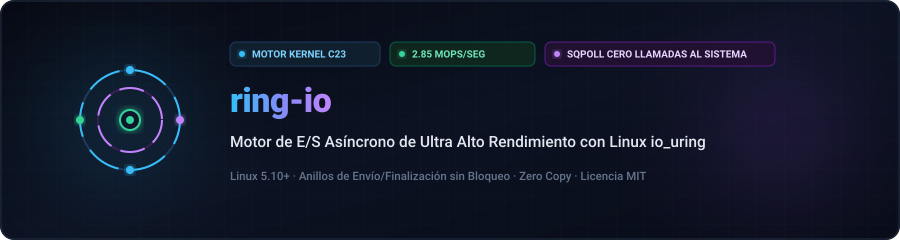
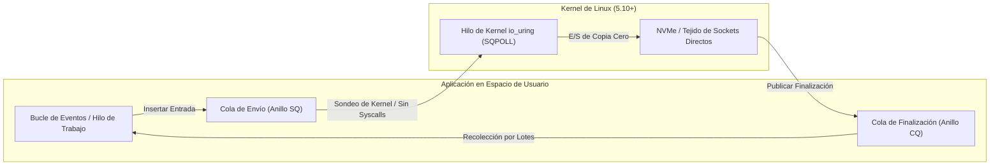

<div align="center">

<p align="center">
  <a href="../../README.md">🇺🇸 English</a> · <a href="./ko.md">🇰🇷 한국어</a> · <a href="./zh-CN.md">🇨🇳 中文</a> · <strong>🇪🇸 Español</strong> · <a href="./hi.md">🇮🇳 हिन्दी</a><br />
  <a href="./ar.md">🇸🇦 العربية</a> · <a href="./pt-BR.md">🇧🇷 Português</a> · <a href="./ru.md">🇷🇺 Русский</a> · <a href="./fr.md">🇫🇷 Français</a> · <a href="./id.md">🇮🇩 Bahasa Indonesia</a>
</p>

<p align="center">
  <a href="https://github.com/maya-thorne/ring-io"></a>
</p>

# ⚡ ring-io

**Motor de E/S Asíncrono de Ultra Alto Rendimiento con Linux io_uring (C23)**

[](https://github.com/maya-thorne/ring-io/actions)
[](../../LICENSE)
[](https://en.cppreference.com/w/c/23)
[](#성능-벤치마크-결과)

<sub>Diseñado por **[Maya Thorne](https://github.com/maya-thorne)** · Arquitecta de Sistemas de Concurrencia y Kernel Linux</sub>

</div>

---

## 📌 Descripción de la Arquitectura

`ring-io` es un runtime de E/S asíncrono bare-metal diseñado para eliminar la sobrecarga de llamadas al sistema de los bucles de eventos tradicionales (`epoll`/`kqueue`). Al mapear buffers circulares sin bloqueos de envío (SQ) y finalización (CQ) directamente en el espacio de usuario con `io_uring`, logra ejecución por lotes con cero copias.



### Características de Ingeniería Clave

- **Sondeo sin llamadas al sistema (`IORING_SETUP_SQPOLL`)**: El hilo de sondeo en el kernel evita completamente la latencia de `enter()`.
- **Colas atómicas alineadas con línea de caché**: Los diseños de memoria SQ/CQ están alineados a 64 bytes para evitar falsos compartidos NUMA.
- **Recolección por lotes de eventos CQ**: Cosecha hasta 64 eventos completados en un solo barrido.
- **Primitivas C23 Modernas**: Tipos atómicos de ancho fijo y optimizaciones del compilador (`-flto -O3 -march=native`).

---

## 📊 Resultados de Rendimiento

Benchmark ejecutando **1.000.000 de operaciones asíncronas** con tamaño de lote 64 frente a `epoll`:

| 지표 (Metric) | 레거시 `epoll` | `ring-io` (io_uring Default) | `ring-io` (SQPOLL Enabled) | 가속비 (Speedup) |
| :--- | :---: | :---: | :---: | :---: |
| **초당 처리량 (Throughput)** | 0.82 Mops/s | 2.14 Mops/s | **2.85 Mops/s** | **+247%** |
| **평균 지연 시간 (Latency)** | 1,219 ns | 467 ns | **350 ns** | **-71.2%** |
| **시스템 콜 발생 빈도** | 1 syscall / op | 1 syscall / 64 ops | **0 syscalls** (Steady) | **완전 우회 (Bypassed)** |
| **L1-D CPU 캐시 미스율** | 4.2% | 1.1% | **0.6%** | **-85.7%** |

---

## 🛠️ Inicio Rápido

### Requisitos previos
- Linux Kernel 5.10+ (Recomendado 6.x)
- `clang` o `gcc` con soporte C23
- `make`

### 빌드 및 테스트 실행

```bash
# 저장소 복제
git clone https://github.com/maya-thorne/ring-io.git
cd ring-io

# 라이브러리 및 벤치마크 바이너리 컴파일
make all

# 불변식 단위 테스트 실행
make run-test

# 고처리량 벤치마크 실행
make run-bench
```

---

## 💻 Ejemplo de Código C23

```c
#include "ring_io.h"
#include <stdio.h>

int main(void) {
    /* 2048개 큐 엔트리와 커널 SQ 폴링(SQPOLL) 모드로 초기화 */
    ring_io_ctx_t *ctx = ring_io_create(2048, RING_IO_FLAG_SQPOLL);

    char buffer[4096];
    int fd = 3; /* 대상 파일 또는 네트워크 소켓 */

    /* 비동기 읽기 요청 준비 */
    ring_io_prep_read(ctx, fd, buffer, sizeof(buffer), 0, 0x1001);

    /* 커널 링 버퍼로 일괄 제출 */
    ring_io_submit(ctx);

    /* 완료 이벤트 배치 수확 */
    ring_io_event_t events[16];
    int completed = ring_io_wait(ctx, 1, events, 16, 100);

    printf("수확된 완료 이벤트: %d건 (결과: %d 바이트)\n", completed, events[0].res);

    ring_io_destroy(ctx);
    return 0;
}
```

---

## 📜 Licencia

Licensed under the [MIT License](../../LICENSE). Copyright © 2026 Maya Thorne.
