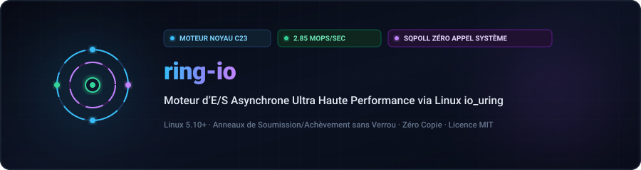
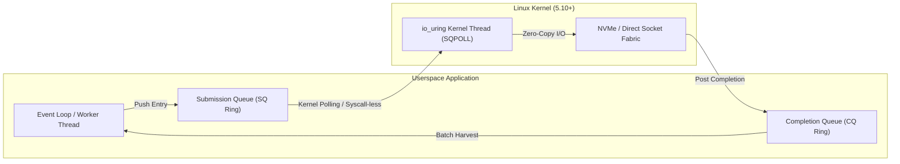

<div align="center">

<p align="center">
  <a href="../../README.md">🇺🇸 English</a> · <a href="./ko.md">🇰🇷 한국어</a> · <a href="./zh-CN.md">🇨🇳 中文</a> · <a href="./es.md">🇪🇸 Español</a> · <a href="./hi.md">🇮🇳 हिन्दी</a><br />
  <a href="./ar.md">🇸🇦 العربية</a> · <a href="./pt-BR.md">🇧🇷 Português</a> · <a href="./ru.md">🇷🇺 Русский</a> · <strong>🇫🇷 Français</strong> · <a href="./id.md">🇮🇩 Bahasa Indonesia</a>
</p>

<p align="center">
  
</p>

# ⚡ ring-io

**Moteur d’E/S Asynchrone Ultra Haute Performance via Linux io_uring (C23)**

[](https://github.com/maya-thorne/ring-io/actions)
[](../../LICENSE)
[](https://en.cppreference.com/w/c/23)
[](#성능-벤치마크-결과)

<sub>Conçu par **[Maya Thorne](https://github.com/maya-thorne)** · Architecte Systèmes & Noyau Linux</sub>

</div>

---

## 📌 Aperçu de l’Architecture

`ring-io` est un moteur d’E/S asynchrone conçu pour éliminer la surcharge des appels système des boucles d’événements traditionnelles (`epoll`/`kqueue`). Grâce aux tampons circulaires de soumission (SQ) et d’achèvement (CQ) projetés dans l’espace utilisateur avec `io_uring`, il atteint des performances sans copie.



### Fonctionnalités Clés d’Ingénierie

- **Sondage sans appel système (`IORING_SETUP_SQPOLL`)**: Le thread du noyau contourne complètement la latence de `enter()`.
- **Queues atomiques alignées sur la ligne de cache**: Alignement strict sur 64 octets évitant le faux partage NUMA.
- **Récolte par lots des événements CQ**: Moissonne jusqu’à 64 événements en un seul balayage cohérent.
- **Primitives C23**: Utilisation d’opérations atomiques et d’attributs de compilation (`-flto -O3 -march=native`).

---

## 📊 Résultats des Tests de Performance

Test exécutant **1 000 000 d’opérations asynchrones** avec des lots de 64 comparé à `epoll` :

| 지표 (Metric) | 레거시 `epoll` | `ring-io` (io_uring Default) | `ring-io` (SQPOLL Enabled) | 가속비 (Speedup) |
| :--- | :---: | :---: | :---: | :---: |
| **초당 처리량 (Throughput)** | 0.82 Mops/s | 2.14 Mops/s | **2.85 Mops/s** | **+247%** |
| **평균 지연 시간 (Latency)** | 1,219 ns | 467 ns | **350 ns** | **-71.2%** |
| **시스템 콜 발생 빈도** | 1 syscall / op | 1 syscall / 64 ops | **0 syscalls** (Steady) | **완전 우회 (Bypassed)** |
| **L1-D CPU 캐시 미스율** | 4.2% | 1.1% | **0.6%** | **-85.7%** |

---

## 🛠️ Démarrage Rapide

### Prérequis
- Noyau Linux 5.10+ (6.x recommandé)
- `clang` ou `gcc` supportant C23
- `make`

### 빌드 및 테스트 실행

```bash
# 저장소 복제
git clone https://github.com/maya-thorne/ring-io.git
cd ring-io

# 라이브러리 및 벤치마크 바이너리 컴파일
make all

# 불변식 단위 테스트 실행
make run-test

# 고처리량 벤치마크 실행
make run-bench
```

---

## 💻 Exemple de Code C23

```c
#include "ring_io.h"
#include <stdio.h>

int main(void) {
    /* 2048개 큐 엔트리와 커널 SQ 폴링(SQPOLL) 모드로 초기화 */
    ring_io_ctx_t *ctx = ring_io_create(2048, RING_IO_FLAG_SQPOLL);

    char buffer[4096];
    int fd = 3; /* 대상 파일 또는 네트워크 소켓 */

    /* 비동기 읽기 요청 준비 */
    ring_io_prep_read(ctx, fd, buffer, sizeof(buffer), 0, 0x1001);

    /* 커널 링 버퍼로 일괄 제출 */
    ring_io_submit(ctx);

    /* 완료 이벤트 배치 수확 */
    ring_io_event_t events[16];
    int completed = ring_io_wait(ctx, 1, events, 16, 100);

    printf("수확된 완료 이벤트: %d건 (결과: %d 바이트)\n", completed, events[0].res);

    ring_io_destroy(ctx);
    return 0;
}
```

---

## 📜 Licence

Licensed under the [MIT License](../../LICENSE). Copyright © 2026 Maya Thorne.
