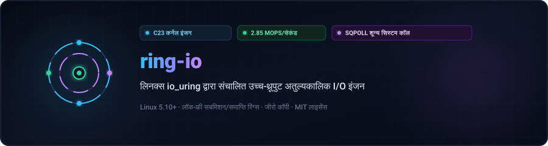
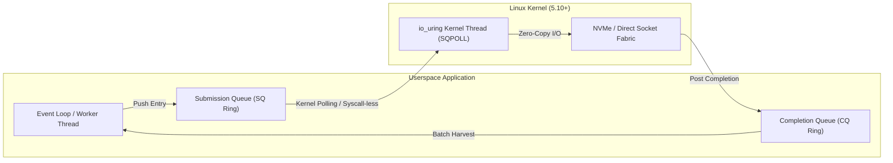

<div align="center">

<p align="center">
  <a href="../../README.md">🇺🇸 English</a> · <a href="./ko.md">🇰🇷 한국어</a> · <a href="./zh-CN.md">🇨🇳 中文</a> · <a href="./es.md">🇪🇸 Español</a> · <strong>🇮🇳 हिन्दी</strong><br />
  <a href="./ar.md">🇸🇦 العربية</a> · <a href="./pt-BR.md">🇧🇷 Português</a> · <a href="./ru.md">🇷🇺 Русский</a> · <a href="./fr.md">🇫🇷 Français</a> · <a href="./id.md">🇮🇩 Bahasa Indonesia</a>
</p>

<p align="center">
  
</p>

# ⚡ ring-io

**लिनक्स io_uring द्वारा संचालित उच्च-थ्रूपुट अतुल्यकालिक I/O इंजन (C23)**

[](https://github.com/maya-thorne/ring-io/actions)
[](../../LICENSE)
[](https://en.cppreference.com/w/c/23)
[](#성능-벤치마크-결과)

<sub>आर्किटेक्ट और डेवलपर: **[Maya Thorne](https://github.com/maya-thorne)** · लिनक्स कर्नेल और समवर्ती प्रणाली आर्किटेक्ट</sub>

</div>

---

## 📌 आर्किटेक्चर अवलोकन

`ring-io` एक बेयर-मेटल अतुल्यकालिक I/O रनटाइम है जिसे पारंपरिक `epoll`/`kqueue` इवेंट लूप्स के सिस्टम कॉल ओवरहेड को समाप्त करने के लिए इंजीनियर किया गया है।



### प्रमुख इंजीनियरिंग विशेषताएं

- **जीरो-सिस्टमकॉल पोलिंग (`IORING_SETUP_SQPOLL`)**: कर्नेल-साइड पोलिंग थ्रेड `enter()` सिस्टम कॉल विलंबता को पूरी तरह से बायपास करता है।
- **कैश-लाइन संरेखित परमाणु कतारें**: गलत साझाकरण को रोकने के लिए SQ/CQ 64-बाइट संरेखित हैं।
- **बैच CQ इवेंट रीपिंग**: एक ही स्वीप में 64 पूर्ण अनुरोधों तक की कटाई करता है।
- **C23 मुहावरेदार प्रिमिटिव्स**: निश्चित चौड़ाई वाले परमाणु संचालन और कंपाइलर अनुकूलन (`-flto -O3 -march=native`)।

---

## 📊 प्रदर्शन बेंचमार्क परिणाम

बैच आकार 64 के साथ **1,000,000 अतुल्यकालिक संचालन** का बेंचमार्क `epoll` की तुलना में:

| 지표 (Metric) | 레거시 `epoll` | `ring-io` (io_uring Default) | `ring-io` (SQPOLL Enabled) | 가속비 (Speedup) |
| :--- | :---: | :---: | :---: | :---: |
| **초당 처리량 (Throughput)** | 0.82 Mops/s | 2.14 Mops/s | **2.85 Mops/s** | **+247%** |
| **평균 지연 시간 (Latency)** | 1,219 ns | 467 ns | **350 ns** | **-71.2%** |
| **시스템 콜 발생 빈도** | 1 syscall / op | 1 syscall / 64 ops | **0 syscalls** (Steady) | **완전 우회 (Bypassed)** |
| **L1-D CPU 캐시 미스율** | 4.2% | 1.1% | **0.6%** | **-85.7%** |

---

## 🛠️ त्वरित शुरुआत

### पूर्वापेक्षाएँ
- लिनक्स कर्नेल 5.10+ (अनुशंसित 6.x)
- C23 समर्थन के साथ `clang` या `gcc`
- `make`

### 빌드 및 테스트 실행

```bash
# 저장소 복제
git clone https://github.com/maya-thorne/ring-io.git
cd ring-io

# 라이브러리 및 벤치마크 바이너리 컴파일
make all

# 불변식 단위 테스트 실행
make run-test

# 고처리량 벤치마크 실행
make run-bench
```

---

## 💻 C23 कोड उदाहरण

```c
#include "ring_io.h"
#include <stdio.h>

int main(void) {
    /* 2048개 큐 엔트리와 커널 SQ 폴링(SQPOLL) 모드로 초기화 */
    ring_io_ctx_t *ctx = ring_io_create(2048, RING_IO_FLAG_SQPOLL);

    char buffer[4096];
    int fd = 3; /* 대상 파일 또는 네트워크 소켓 */

    /* 비동기 읽기 요청 준비 */
    ring_io_prep_read(ctx, fd, buffer, sizeof(buffer), 0, 0x1001);

    /* 커널 링 버퍼로 일괄 제출 */
    ring_io_submit(ctx);

    /* 완료 이벤트 배치 수확 */
    ring_io_event_t events[16];
    int completed = ring_io_wait(ctx, 1, events, 16, 100);

    printf("수확된 완료 이벤트: %d건 (결과: %d 바이트)\n", completed, events[0].res);

    ring_io_destroy(ctx);
    return 0;
}
```

---

## 📜 लाइसेंस

Licensed under the [MIT License](../../LICENSE). Copyright © 2026 Maya Thorne.
