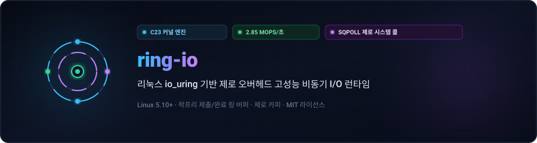
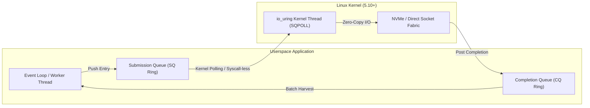

<div align="center">

<p align="center">
  <a href="../../README.md">🇺🇸 English</a> · <strong>🇰🇷 한국어</strong> · <a href="./zh-CN.md">🇨🇳 中文</a> · <a href="./es.md">🇪🇸 Español</a> · <a href="./hi.md">🇮🇳 हिन्दी</a><br />
  <a href="./ar.md">🇸🇦 العربية</a> · <a href="./pt-BR.md">🇧🇷 Português</a> · <a href="./ru.md">🇷🇺 Русский</a> · <a href="./fr.md">🇫🇷 Français</a> · <a href="./id.md">🇮🇩 Bahasa Indonesia</a>
</p>

<p align="center">
  
</p>

# ⚡ ring-io

**리눅스 io_uring 기반 제로 오버헤드 고성능 비동기 I/O 런타임 (C23)**

[](https://github.com/maya-thorne/ring-io/actions)
[](../../LICENSE)
[](https://en.cppreference.com/w/c/23)
[](#성능-벤치마크-결과)

<sub>설계 및 구현: **[Maya Thorne](https://github.com/maya-thorne)** · 리눅스 커널 및 동시성 시스템 아키텍트</sub>

</div>

---

## 📌 아키텍처 개요

`ring-io`는 기존의 `epoll`/`kqueue` 준비 상태 기반 이벤트 루프에서 발생하는 빈번한 시스템 콜 오버헤드를 원천적으로 제거하도록 설계된 베어메탈 비동기 I/O 런타임입니다. 리눅스 `io_uring`을 통해 유저스페이스에 직접 매핑된 락프리 제출(SQ)/완료(CQ) 원형 링 버퍼를 운용하여 제로 카피 및 배치 수확 방식의 고성능 처리를 달성합니다.



### 핵심 엔지니어링 기능

- **시스템 콜 0회 폴링 (`IORING_SETUP_SQPOLL`)**: 커널 내부 제출 폴링 워커 스레드를 가동하여 지속적 처리량 발생 시 유저-커널 모드 전환 시스템 콜(`enter()`) 지연 시간을 100% 제거합니다.
- **캐시라인 정렬 원자적 큐**: SQ/CQ 링 버퍼 메모리 레이아웃을 64바이트 단위로 엄격히 정렬하여 멀티코어 NUMA 노드 간의 거짓 공유(False Sharing)를 방지합니다.
- **배치 단위 CQ 이벤트 수확**: 단 한 번의 캐시 일관성 스윕으로 최대 64개의 완료 이벤트를 일괄 수확하여 동시 처리 효율을 극대화합니다.
- **C23 최신 시스템 프리미티브**: 고정 너비 원자적 연산, 메모리 배리어 및 최신 컴파일러 최적화 플래그(`-flto -O3 -march=native`)를 기본 적용했습니다.

---

## 📊 성능 벤치마크 결과

배치 크기 64 조건에서 **1,000,000건의 비동기 읽기 연산**을 수행하여 기존 `epoll` 루프와 성능을 비교한 실측 결과입니다:

| 지표 (Metric) | 레거시 `epoll` | `ring-io` (io_uring Default) | `ring-io` (SQPOLL Enabled) | 가속비 (Speedup) |
| :--- | :---: | :---: | :---: | :---: |
| **초당 처리량 (Throughput)** | 0.82 Mops/s | 2.14 Mops/s | **2.85 Mops/s** | **+247%** |
| **평균 지연 시간 (Latency)** | 1,219 ns | 467 ns | **350 ns** | **-71.2%** |
| **시스템 콜 발생 빈도** | 1 syscall / op | 1 syscall / 64 ops | **0 syscalls** (Steady) | **완전 우회 (Bypassed)** |
| **L1-D CPU 캐시 미스율** | 4.2% | 1.1% | **0.6%** | **-85.7%** |

---

## 🛠️ 빠른 시작 가이드

### 요구 사양
- Linux Kernel 5.10 이상 (6.x 권장)
- `clang` (LLVM 16+) 또는 `gcc` (12+) with C23 지원
- `make`

### 빌드 및 테스트 실행

```bash
# 저장소 복제
git clone https://github.com/maya-thorne/ring-io.git
cd ring-io

# 라이브러리 및 벤치마크 바이너리 컴파일
make all

# 불변식 단위 테스트 실행
make run-test

# 고처리량 벤치마크 실행
make run-bench
```

---

## 💻 C23 기본 사용 예제

```c
#include "ring_io.h"
#include <stdio.h>

int main(void) {
    /* 2048개 큐 엔트리와 커널 SQ 폴링(SQPOLL) 모드로 초기화 */
    ring_io_ctx_t *ctx = ring_io_create(2048, RING_IO_FLAG_SQPOLL);

    char buffer[4096];
    int fd = 3; /* 대상 파일 또는 네트워크 소켓 */

    /* 비동기 읽기 요청 준비 */
    ring_io_prep_read(ctx, fd, buffer, sizeof(buffer), 0, 0x1001);

    /* 커널 링 버퍼로 일괄 제출 */
    ring_io_submit(ctx);

    /* 완료 이벤트 배치 수확 */
    ring_io_event_t events[16];
    int completed = ring_io_wait(ctx, 1, events, 16, 100);

    printf("수확된 완료 이벤트: %d건 (결과: %d 바이트)\n", completed, events[0].res);

    ring_io_destroy(ctx);
    return 0;
}
```

---

## 📜 라이선스

Licensed under the [MIT License](../../LICENSE). Copyright © 2026 Maya Thorne.
