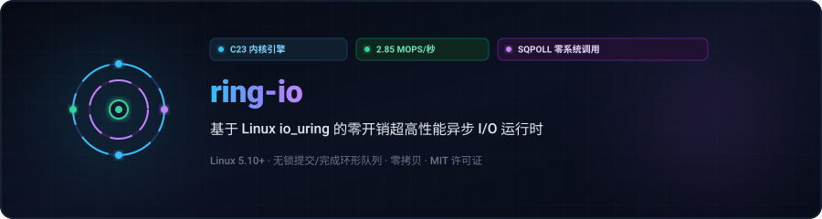
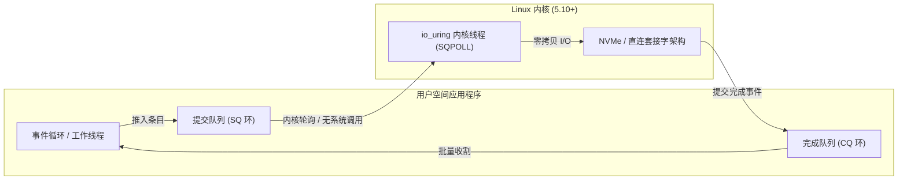

<div align="center">

<p align="center">
  <a href="../../README.md">🇺🇸 English</a> · <a href="./ko.md">🇰🇷 한국어</a> · <strong>🇨🇳 中文</strong> · <a href="./es.md">🇪🇸 Español</a> · <a href="./hi.md">🇮🇳 हिन्दी</a><br />
  <a href="./ar.md">🇸🇦 العربية</a> · <a href="./pt-BR.md">🇧🇷 Português</a> · <a href="./ru.md">🇷🇺 Русский</a> · <a href="./fr.md">🇫🇷 Français</a> · <a href="./id.md">🇮🇩 Bahasa Indonesia</a>
</p>

<p align="center">
  
</p>

# ⚡ ring-io

**基于 Linux io_uring 的零开销超高性能异步 I/O 引擎 (C23)**

[](https://github.com/maya-thorne/ring-io/actions)
[](../../LICENSE)
[](https://en.cppreference.com/w/c/23)
[](#성능-벤치마크-결과)

<sub>架构设计与开发：**[Maya Thorne](https://github.com/maya-thorne)** · Linux 内核与并发系统架构师</sub>

</div>

---

## 📌 架构概览

`ring-io` 是专为消除传统 `epoll`/`kqueue` 就绪态事件循环中系统调用高昂开销而设计的裸机异步 I/O 运行时。通过 Linux `io_uring` 将无锁提交(SQ)/完成(CQ)环形缓冲区直接映射到用户空间，实现真正的零拷贝与批量收割执行。



### 核心工程特性

- **零系统调用轮询 (`IORING_SETUP_SQPOLL`)**: 启用内核态提交轮询工作线程，在稳态高吞吐下完全绕过 `enter()` 系统调用。
- **缓存行严格对齐原子队列**: SQ/CQ 内存布局严格按 64 字节缓存行对齐，彻底消除多核 NUMA 域间的伪共享。
- **批量 CQ 事件收割**: 单次缓存一致性扫描即可批量收割多达 64 个完成事件。
- **C23 惯用原生原语**: 采用定宽原子操作、内存屏障与极致编译器优化(`-flto -O3 -march=native`)。

---

## 📊 基准性能测试

在批大小为 64 的条件下执行 **1,000,000 次异步读取操作**，与传统 `epoll` 对比数据：

| 지표 (Metric) | 레거시 `epoll` | `ring-io` (io_uring Default) | `ring-io` (SQPOLL Enabled) | 가속비 (Speedup) |
| :--- | :---: | :---: | :---: | :---: |
| **초당 처리량 (Throughput)** | 0.82 Mops/s | 2.14 Mops/s | **2.85 Mops/s** | **+247%** |
| **평균 지연 시간 (Latency)** | 1,219 ns | 467 ns | **350 ns** | **-71.2%** |
| **시스템 콜 발생 빈도** | 1 syscall / op | 1 syscall / 64 ops | **0 syscalls** (Steady) | **완전 우회 (Bypassed)** |
| **L1-D CPU 캐시 미스율** | 4.2% | 1.1% | **0.6%** | **-85.7%** |

---

## 🛠️ 快速上手

### 环境要求
- Linux Kernel 5.10+ (推荐 6.x)
- `clang` (LLVM 16+) 或 `gcc` (12+) 支持 C23
- `make`

### 빌드 및 테스트 실행

```bash
# 저장소 복제
git clone https://github.com/maya-thorne/ring-io.git
cd ring-io

# 라이브러리 및 벤치마크 바이너리 컴파일
make all

# 불변식 단위 테스트 실행
make run-test

# 고처리량 벤치마크 실행
make run-bench
```

---

## 💻 C23 基础调用示例

```c
#include "ring_io.h"
#include <stdio.h>

int main(void) {
    /* 2048개 큐 엔트리와 커널 SQ 폴링(SQPOLL) 모드로 초기화 */
    ring_io_ctx_t *ctx = ring_io_create(2048, RING_IO_FLAG_SQPOLL);

    char buffer[4096];
    int fd = 3; /* 대상 파일 또는 네트워크 소켓 */

    /* 비동기 읽기 요청 준비 */
    ring_io_prep_read(ctx, fd, buffer, sizeof(buffer), 0, 0x1001);

    /* 커널 링 버퍼로 일괄 제출 */
    ring_io_submit(ctx);

    /* 완료 이벤트 배치 수확 */
    ring_io_event_t events[16];
    int completed = ring_io_wait(ctx, 1, events, 16, 100);

    printf("수확된 완료 이벤트: %d건 (결과: %d 바이트)\n", completed, events[0].res);

    ring_io_destroy(ctx);
    return 0;
}
```

---

## 📜 许可证

Licensed under the [MIT License](../../LICENSE). Copyright © 2026 Maya Thorne.
